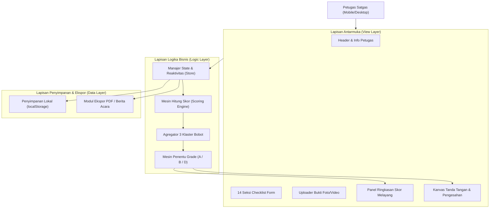

# ARCHITECTURE.md: Arsitektur Sistem Kloning & Penilaian SPPG

Dokumen ini menjelaskan struktur arsitektur teknis sistem checklist kelayakan operasional SPPG Satgas MBG Kabupaten/Kota berdasarkan antarmuka resmi BGN dan dokumen [Paparan.pdf](file:///c:/Users/Ayrez/Documents/rez/Paparan.pdf).

---

## 1. Diagram Arsitektur Tingkat Tinggi



---

## 2. Rincian Komponen Arsitektur

### 1. View Layer (Antarmuka Pengguna)
* **Form Builder Engine:** Merender struktur 14 seksi formulir yang identik dengan platform Nuxt/OpenForm BGN.
* **Accessible Custom Dropdowns:** Komponen pemilih kustom untuk pencarian Kabupaten/Kota di seluruh Indonesia dan jurusan pengawas gizi.
* **Radio Card Group:** Komponen tombol radio bergaya kartu yang ramah sentuhan (touch-friendly) untuk inspeksi cepat di lapangan.
* **Evidence Dropzones:** Uploader berkas berkemampuan drag-and-drop, validasi ekstensi/ukuran (50MB/200MB), simulasi timestamp, dan pemicu kamera perangkat langsung (`capture="environment"`).
* **Floating Score HUD:** Bilah melayang (sticky floating bar) yang menampilkan skor terkini, klaster keamanan pangan, dan badge rekomendasi tanpa mengalihkan pandangan pengisi form.
* **Canvas Signature Pad:** Kanvas HTML5 interaktif untuk membubuhkan tanda tangan digital Ketua Satgas MBG.

### 2. State Store (Manajemen Status)
* Menyimpan seluruh status isian form (76 input).
* Mengelola status validasi (misal: panjang NIK tepat 16 digit angka, format tanggal, ketersediaan lampiran wajib).
* Mekanisme *Auto-Save* ke `localStorage` setiap kali terjadi mutasi nilai input untuk mencegah hilangnya data di lapangan.

### 3. Scoring Engine (Mesin Kalkulasi Skor 14 Indikator)
Setiap indikator dihitung menggunakan fungsi deterministik sesuai aturan di [Paparan.pdf](file:///c:/Users/Ayrez/Documents/rez/Paparan.pdf):

1. **`calcLegalitas(data)` (Maks 12%):**
   * SLHS = 6% jika ada; Halal = 2%; PBG = 2%; SLF = 2%.
2. **`calcStaff(data)` (Maks 5%):**
   * Kepala SPPG ada = 2%.
   * Pengawas Gizi: Ahli Gizi = 2%, Relevan (Tekpang/Kesmas) = 1%, Tidak ada = 0%.
   * Pengawas Keuangan ada = 1%.
3. **`calcChef(data)` (Maks 6%):**
   * Kehadiran = 3%; Paklaring / Masa kerja ≥ 1 tahun = 3%.
4. **`calcAirMinum(data)` (Maks 7%):**
   * Mengambil nilai tertinggi dari jenis terpilih: RO (7%), Galon (6%), PDAM (4%), Sumur (0%).
5. **`calcAirMasak(data)` (Maks 9%):**
   * Nilai tertinggi dari jenis terpilih: RO (9%), Galon (8%), PDAM (6%), Sumur (2%).
6. **`calcColdChain(data)` (Maks 11%):**
   * Chiller (5%): Suhu ≤ 5°C = 5%, Suhu > 5°C = 3%, Rusak/Tdk terbaca = 0%.
   * Freezer (6%): Suhu ≤ -18°C = 6%, Suhu > -18°C = 3%, Rusak/Tdk terbaca = 0%.
7. **`calcKompor(data)` (Maks 4%):**
   * Menghitung rasio: $Rasio = \frac{\text{Kompor Berfungsi} \times 450}{\text{Jumlah PM}}$.
   * Jika $Rasio \ge 1$ dan High Pressure ada: skor 4% (semua baik) atau 2% (ada rusak).
   * Jika $Rasio \ge 1$ tanpa High Pressure: skor 1%.
   * Jika $Rasio < 1$: skor 0%.
8. **`calcSanitasi(data)` (Maks 12%):**
   * Wastafel: $\sum (\text{Wastafel Berfungsi \& Sabun Ada}) \times 1.2\%$ pada 5 titik lokasi (Maks 6%).
   * IPAL berfungsi = 4%; Grease Trap berfungsi = 2%.
9. **`calcAPAR(data)` (Maks 5%):**
   * Tersedia & masa berlaku aktif = 5%, Kadaluarsa/Tidak ada = 0%.
10. **`calcLabelOmpreng(data)` (Maks 3%):**
    * Info batas waktu konsumsi (1.5%) + Info dilarang bawa pulang (1.5%).
11. **`calcLuasan(data)` (Maks 7%):**
    * Mengecek luas bangunan terhadap tabel batas PM (160m²: 500 PM, 240m²: 1500 PM, 320m²: 2500 PM, 400m²: 3000 PM).
    * Sesuai standar = 7%, Di bawah standar = 3%, Tidak dapat dinilai = 0%.
12. **`calcGudang(data)` (Maks 8%):**
    * Gudang Kering: Rak (Stainless 2%, Besi/Plastik 1.75%, Kayu/Tdk ada 0%) + Palet (Stainless 2%, Besi/Plastik 1.75%, Kayu/Tdk ada 0%).
    * Gudang Basah: Rak (Maks 2%) + Palet (Maks 2%). Total akumulasi = 8%.
13. **`calcAlurProduksi(data)` (Maks 8%):**
    * Sesuai tanpa pengecualian (ada sekat penuh) = 8%.
    * Sesuai dengan catatan (tanpa sekat penuh) = 6%.
    * Tidak sesuai dengan catatan = 4%.
14. **`calcCCTV(data)` (Maks 3%):**
    * Terpasang di 10 titik kritis = 1.5%.
    * Speed test internet ada dan tercatat = 1.5%.

---

## 3. Skema Data (JSON Schema)

```json
{
  "sppg_id": "HVUXYKN6",
  "sppg_name": "SPPG ACEH TIMUR RANTO PEUREULAK BUKET PALA",
  "target_pm": 3000,
  "kab_kota": "ACEH TIMUR",
  "petugas_name": "Rahmat Hidayat",
  "inspection_date": "2026-11-19",
  "checklist": {
    "legalitas": {
      "slhs": true,
      "halal": true,
      "pbg": true,
      "slf": false
    },
    "staff": {
      "kepala_sppg_present": true,
      "gizi_present": true,
      "gizi_major": "Ilmu Gizi",
      "keuangan_present": true
    },
    "chef": {
      "chef_present": true,
      "chef_paklaring": true
    },
    "air_minum": "RO",
    "air_masak": "RO",
    "cold_chain": {
      "chiller_temp": 4,
      "chiller_ok": true,
      "freezer_temp": -20,
      "freezer_ok": true
    },
    "kompor": {
      "high_pressure_qty": 4,
      "low_pressure_qty": 4,
      "kompor_ok": true
    },
    "sanitasi": {
      "wastafel_persiapan": true,
      "wastafel_pemorsian": true,
      "wastafel_pengolahan": true,
      "wastafel_km": true,
      "wastafel_masuk": true,
      "ipal_ok": true,
      "grease_trap_ok": true
    },
    "apar": {
      "available": true,
      "valid": true
    },
    "label_ompreng": {
      "has_time_limit": true,
      "has_no_takeaway": true
    },
    "luas_bangunan": 350,
    "gudang": {
      "kering_rak": "Stainless steel",
      "kering_palet": "Stainless steel",
      "basah_rak": "Stainless steel",
      "basah_palet": "Stainless steel"
    },
    "alur_produksi": "sekat_penuh",
    "cctv": {
      "titik_kritis_ok": true,
      "speedtest_ok": true
    }
  },
  "scores": {
    "total": 98.0,
    "cluster_keamanan_pangan": 63.0,
    "cluster_legalitas_sdm": 23.0,
    "cluster_lahan_k3": 12.0,
    "grade": "Layak Dilanjutkan"
  },
  "recommendation": {
    "status": "Layak Dilanjutkan",
    "notes": "Dapur sangat representatif, standar higienitas dan kapasitas terpenuhi optimal.",
    "signature_svg": "data:image/svg+xml;base64,..."
  }
}
```

---

## 4. Keamanan & Kebijakan Data
* **Data Sanitization:** Semua string input disaring untuk menghindari XSS.
* **File Upload Safety:** Berkas foto/video ditangani di sisi peramban (`URL.createObjectURL`) tanpa pengiriman ke server pihak ketiga yang tidak terotorisasi.
