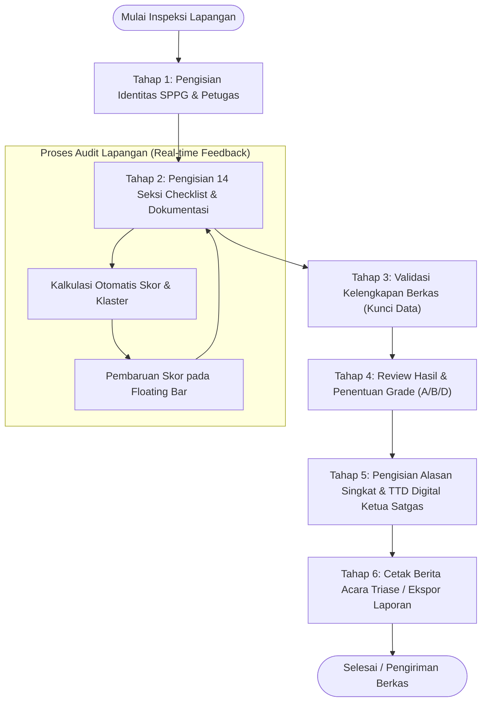

# WORKFLOW.md: Alur Kerja Operasional Triase Lapangan SPPG

Dokumen ini memetakan alur kerja lengkap (end-to-end operational workflow) pelaksanaan audit dan penilaian kelayakan operasional SPPG oleh Satuan Tugas MBG Kabupaten/Kota.

---

## 1. Diagram Alur Kerja

---

## 2. Rincian Langkah Operasional

### Tahap 1: Pra-Inspeksi & Registrasi Identitas
1. Petugas membuka aplikasi di ponsel pintar atau tablet di lokasi SPPG.
2. Memasukkan **ID SPPG** (8 digit), **Nama SPPG**, dan target **Jumlah PM (porsi/hari)**.
3. Memilih wilayah **Kab/Kota** dari dropdown pencarian.
4. Memasukkan nama **Petugas Satgas** dan menetapkan **Tanggal Inspeksi**.

### Tahap 2: Pelaksanaan Audit Lapangan (14 Seksi)
1. **Seksi Legalitas Dokumen:** Cek fisik berkas asli SLHS, Halal, PBG, SLF; ambil foto berkas ber-timestamp.
2. **Seksi SDM (Staff & Chef):** Verifikasi kehadiran Kepala SPPG, Pengawas Gizi (cek ijazah/jurusan), Pengawas Keuangan, dan Chef (cek paklaring); ambil foto personel memegang KTP di depan plang SPPG.
3. **Seksi Air:** Uji dan foto sumber air minum & masak (RO/Galon/PDAM/Sumur).
4. **Seksi Rantai Dingin:** Catat suhu display Chiller (≤5°C) dan Freezer (≤-18°C); foto display termometer.
5. **Seksi Kompor:** Hitung jumlah kompor low/high pressure; aplikasi otomatis menghitung kecukupan rasio porsi.
6. **Seksi Sanitasi Dasar:** Periksa ketersediaan wastafel & sabun di 5 titik; periksa fungsi IPAL & Grease Trap terbuka.
7. **Seksi APAR & Ompreng:** Periksa tanggal kadaluarsa APAR; verifikasi stempel informasi pada label ompreng.
8. **Seksi Lahan, Gudang & Alur:** Ukur luasan bangunan vs PM; cek material rak/palet (larangan palet kayu); rekam video alur produksi dari bahan baku hingga distribusi.
9. **Seksi CCTV & Internet:** Verifikasi rekaman 10 titik kritis; jalankan speed test koneksi internet di HP.

### Tahap 3: Validasi & Penguncian Data
* Sistem memvalidasi apakah ada kolom wajib atau foto mandatori yang belum terlampir.
* Menampilkan callout peringatan merah sebelum data dikunci untuk lanjut ke tahap rekomendasi.

### Tahap 4: Evaluasi Rekomendasi & Pengesahan
* Sistem mengumumkan total skor persentase akhir (0–100%) dan grade:
  * **Grade A (≥80%):** Layak Dilanjutkan (Hijau).
  * **Grade B (60–79.9%):** Layak Dilanjutkan dengan Perbaikan (Kuning).
  * **Grade D (<60%):** Tidak Layak Dilanjutkan (Merah).
* Ketua Satgas MBG Kabupaten/Kota menuliskan pertimbangan/alasan singkat (maksimal 2 baris).
* Ketua Satgas menandatangani dokumen langsung pada kanvas digital.

### Tahap 5: Cetak & Pengiriman Hasil
* Menghasilkan lembar **Berita Acara Triase Lapangan** berformat standar cetak resmi BGN (sesuai halaman 3 [Paparan.pdf](file:///c:/Users/Ayrez/Documents/rez/Paparan.pdf)).
* Mengirimkan berkas atau menyimpan salinan digital untuk arsip tim Satgas.
